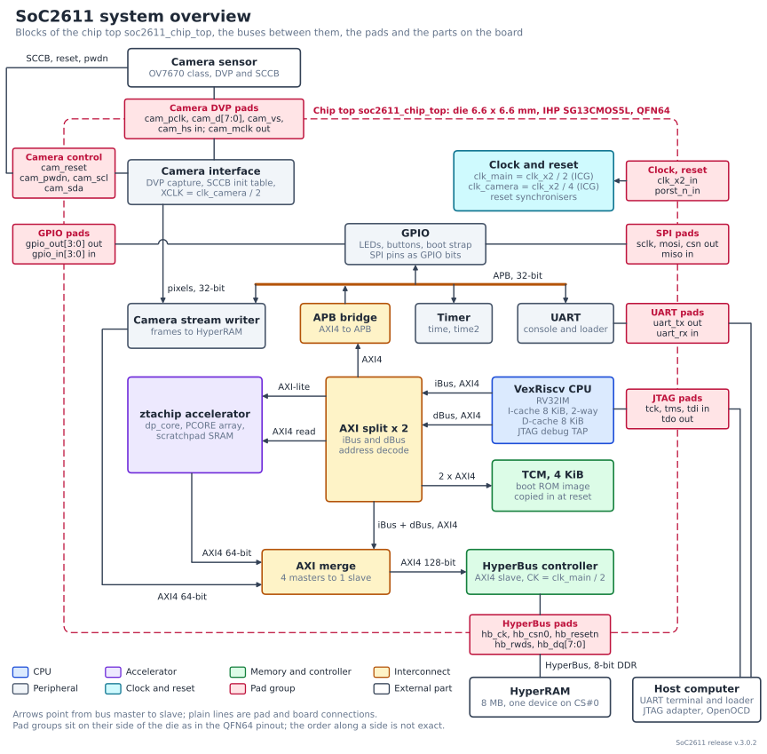

# SoC2611 system overview

SoC2611 is a RISC-V system on chip for vision and AI work at the edge. A VexRiscv CPU runs the firmware and
sends tensor instructions to the ztachip accelerator. Both use an external HyperRAM as main memory. A camera input
writes video frames into the same memory. The chip is made in IHP SG13CMOS5L on a 6.6 x 6.6 mm die in a QFN64
package. Release v.3.0.2 is the version for fabrication.

This page shows the blocks of the chip top `soc2611_chip_top` and how they connect. The inside of the accelerator
is described in a separate document. The address map is in the memory map document.

*Top-level blocks of SoC2611 and the buses between them, with the pad groups on their die side and the parts on
the board.*

## Main numbers

The values come from `doc/Specification.md`. The right column shows what the design files of release v.3.0.2 say
where we checked them.

| Item | doc/Specification.md | Checked in the design |
|---|---|---|
| Accelerator PCOREs | 4 (1 cell x 4) | 4: routed netlist v.3.0.2 has one cell with four PCORE instances; RTL configuration `pid_gen_max_c = 4` |
| Threads per PCORE | 16 | 16 (`tid_max_c`) |
| SRAM macros | 298 RM_IHPSG13 macros, 214 KiB, about 12.9 mm² | 298 macros in the routed netlist |
| Standard cells | about 290k after synthesis (about 6.2 mm²), about 335k after place and route | not checked |
| Die | 6600 x 6600 µm, seal ring at the die edge | not checked |
| Core | 5920 x 5920 µm (340 µm pad-ring margin) | not checked |
| Package | QFN64: 64 pads, 48 signal and 16 supply | 48 signal and 16 supply pins in the QFN64 pinout |
| Process | IHP SG13CMOS5L, CMOS only, Metal1 to Metal4 and TopMetal1, 1.2 V core, 3.3 V IO | not checked |
| System clock, maximum | 29.4 MHz slow, 45.5 MHz typical, 64.4 MHz fast corner | not checked |

## Blocks

**VexRiscv CPU.** An RV32IM core with an 8 KiB two-way instruction cache and an 8 KiB one-way data cache. It has
two 32-bit AXI4 masters, a read-only instruction bus and a data bus. The JTAG debug TAP has a 4-bit instruction
register and IDCODE `0x10001FFF`. The reset vector is `0x0000_0000`.

**TCM.** A 4 KiB on-chip RAM at address 0. Right after reset it copies the 396-byte boot ROM image into itself and
holds the CPU in reset until the copy is done. The instruction bus and the data bus each have a read port. The
data bus also has the write port.

**AXI split.** There is one address decoder for each CPU bus. The instruction bus reaches the TCM and main memory.
The data bus reaches the TCM, main memory, the accelerator registers, a read-only port into the accelerator
scratchpad, and the APB bridge.

**AXI merge.** It joins four masters onto the single 128-bit AXI4 port of the HyperBus controller. The masters are
the accelerator DMA, the camera stream writer, the CPU instruction bus and the CPU data bus. A fifth input, for
the video read DMA, is tied off because the VGA output is not built into this chip. The accelerator and the camera
writer reach only the HyperRAM, not the TCM or the peripherals.

**HyperBus controller.** An AXI4 slave that turns bursts into HyperBus transactions. It drives one 8 MB HyperRAM on
chip select CS#0. The HyperBus clock is `clk_main / 2`. An on-chip chain of 12 delay cells delays the RWDS strobe by
about 4.5 ns typical, so that the current data byte is captured.

**ztachip accelerator.** It has the tensor processor dp_core, the PCORE array and a 16 KiB scratchpad SRAM. The CPU
writes tensor instructions through an AXI-lite slave. The accelerator moves tensor data to and from the HyperRAM
through its own 64-bit AXI4 master.

**Camera interface.** It captures the 8-bit DVP pixel bus of an OV7670 class sensor on the pixel clock `cam_pclk`
and packs the pixels into a 32-bit stream. After reset it programs the sensor over SCCB from a fixed register
table. It also drives the sensor clock on `cam_mclk`, which is `clk_camera / 2`.

**Camera stream writer.** It moves the pixel stream through an asynchronous FIFO into the system clock domain. It
then writes the frames into HyperRAM over a 64-bit AXI4 master. The firmware sets the enable and four frame buffer
addresses through APB registers, and reads back the index of the frame being written.

**APB bridge.** The only APB master. It connects the CPU data bus window at `0xC000_0000` to a 32-bit APB bus. The
peripherals decode the low 8 address bits.

**GPIO.** Output bits 3 to 0 drive the LED pads `gpio_out`. Input bits 3 to 0 read the button pads `gpio_in`, and
`gpio_in[3]` is the boot strap. Output bits 4, 5 and 6 drive `spi_csn`, `spi_sclk` and `spi_mosi`. Input bit 4
reads `spi_miso`. The SPI master is firmware working on these GPIO bits.

**Timer.** It has two counters. `time` counts once every 125,000 system clocks. `time2` counts every system clock.

**UART.** 8 data bits, no parity, 1 stop bit, with a bit time of 1085 system clocks. It carries the console and the
boot loader.

**Clock and reset.** There is no PLL. Two integrated clock gating cells make `clk_main = clk_x2 / 2` and
`clk_camera = clk_x2 / 4` from the pad clock `clk_x2_in`. The double-pumped memories run on `clk_x2` itself.
The power-on reset `porst_n_in` goes through a reset synchroniser for `clk_main` and one for `clk_camera`. JTAG
TCK clocks its own domain inside the CPU debug logic.

## Bus connections

| From | To | Protocol | Data width |
|---|---|---|---|
| CPU instruction bus | AXI split | AXI4, read only | 32 bit |
| CPU data bus | AXI split | AXI4 | 32 bit |
| AXI split | TCM | AXI4, 2 read ports and 1 write port | 32 bit |
| AXI split | accelerator registers | AXI-lite | 32 bit |
| AXI split | accelerator scratchpad | AXI4, read only | 32 bit |
| AXI split | APB bridge | AXI4 | 32 bit |
| AXI split | AXI merge | AXI4, instruction and data bus | 32 bit each |
| Accelerator DMA | AXI merge | AXI4 | 64 bit |
| Camera stream writer | AXI merge | AXI4, write only | 64 bit |
| AXI merge | HyperBus controller | AXI4 | 128 bit |
| HyperBus controller | HyperRAM | HyperBus | 8 bit, double data rate |
| Camera interface | camera stream writer | pixel stream | 32 bit |
| APB bridge | GPIO, timer, UART, camera stream writer | APB, 20-bit address, low 8 bits decoded | 32 bit |

## Pad groups

All signal pads are 3.3 V `sg13cmos5l_io` cells. The side is the die side in the QFN64 pinout of
`doc/Datasheet.md`.

| Group | Side | Pins | Signals |
|---|---|---:|---|
| Camera control | west | 4 | `cam_reset`, `cam_pwdn`, `cam_scl` out, `cam_sda` open drain |
| GPIO | west | 8 | `gpio_out[3:0]` out, `gpio_in[3:0]` in |
| HyperBus | south | 12 | `hb_ck`, `hb_csn0`, `hb_resetn` out, `hb_rwds`, `hb_dq[7:0]` in and out |
| UART | east | 2 | `uart_tx` out, `uart_rx` in |
| SPI | east | 4 | `spi_sclk`, `spi_mosi`, `spi_csn` out, `spi_miso` in |
| Clock and reset | east | 2 | `clk_x2` in, `porst_n` in |
| JTAG | east | 4 | `jtag_tck`, `jtag_tms`, `jtag_tdi` in, `jtag_tdo` out |
| Camera DVP | north | 12 | `cam_pclk`, `cam_d[7:0]`, `cam_vs`, `cam_hs` in, `cam_mclk` out |
| Supply | 4 per side | 16 | one VDD, VSS, IOVDD and IOVSS pad on each side |

## Sources

- `doc/Specification.md`: function, technology and physical data, ratings.
- `doc/Interfaces.md`: pin groups, protocols, clocks, HyperBus RWDS delay chain, JTAG TAP.
- `doc/Datasheet.md`: QFN64 pinout and pad sides.
- `doc/RegisterMap.md`: address map, configuration of this chip.
- `SoC2611-main/docs/asic_jtag_README.md`: VexRiscv configuration, JTAG TAP, OpenOCD.
- `SoC2611-main/docs/ASIC_PORT.md`: double-pumped memories on `clk_x2`.
- `SoC2611-main/synthesis/inventory.md` and `SoC2611-main/synthesis/synth_stat.txt`: SRAM macros, module list.
- `SoC2611-main/constraints/design.sdc`: generated clocks `clk_main`, `clk_camera`, `cam_mclk`, `hb_ck`.
- `SoC2611-main/rtl/SoC2611.v`: exported RTL of the design, module list.
- `release/v.3.0.2/netlist/SoC2611.v.gz`: routed netlist, SRAM macro and PCORE instances.
- Design repository, chip level: `HW/asic/rtl/` (chip top), `HW/asic/rtl/config.vhd`, `HW/asic/rtl/clk_gate.vhd`,
  `HW/asic/rtl/reset_sync.vhd`, `HW/asic/rtl/boot_rom_pkg.vhd`, `HW/asic/rtl/hyperbus/hyperbus_axi.vhd`,
  `HW/asic/fw/bootrom/link.ld`.
- Design repository, SoC: `HW/src/soc/soc_base.vhd`, `HW/src/soc/tcm.vhd`, `HW/src/soc/axi/axi_split.vhd`,
  `HW/src/soc/axi/axi_split_read.vhd`, `HW/src/soc/axi/axi_merge.vhd`, `HW/src/soc/axi/axi_apb_bridge.vhd`,
  `HW/src/soc/axi/axi_stream_write.vhd`, `HW/src/soc/peripherals/camera.vhd`, `HW/src/soc/peripherals/gpio.vhd`,
  `HW/src/soc/peripherals/time.vhd`, `HW/src/soc/peripherals/uart.vhd`.
- Design repository, accelerator and CPU: `HW/src/top/ztachip.vhd`, `HW/src/top/sram_core.vhd`,
  `HW/src/top/cell.vhd`, `HW/src/pcore/core.vhd`, `HW/src/ztachip_pkg.vhd`, `HW/riscv/asic_jtag/riscv.scala`.
