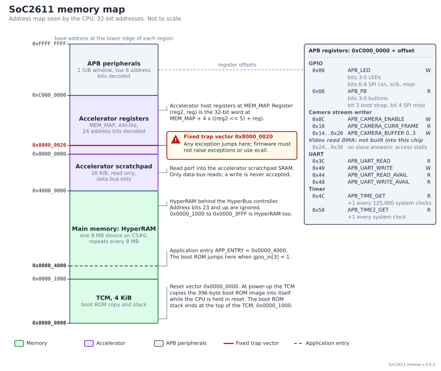

# SoC2611 memory map

The VexRiscv CPU of SoC2611 uses 32-bit addresses. Two address decoders, one on the instruction bus and one on the
data bus, split the address space into the TCM, the main memory in the external HyperRAM, two accelerator windows
and the APB peripherals. This page shows the map as the CPU sees it. It starts from `doc/RegisterMap.md` and was
checked against the address decoders in the RTL of release v.3.0.2.

*Address map seen by the CPU, not to scale, with the reset vector, the application entry, the fixed trap vector
and the APB register offsets.*

## Regions

| Base | End | Region | Reached by |
|---|---|---|---|
| `0x0000_0000` | `0x0000_0FFF` | TCM, 4 KiB | instruction bus and data bus |
| `0x0000_1000` | `0x3FFF_FFFF` | main memory: one 8 MB HyperRAM on CS#0 | instruction bus and data bus |
| `0x4000_0000` | `0x7FFF_FFFF` | accelerator scratchpad SRAM, 16 KiB, read only | data bus only |
| `0x8000_0000` | `0xBFFF_FFFF` | accelerator host registers, `MEM_MAP` | data bus only |
| `0xC000_0000` | `0xFFFF_FFFF` | APB peripherals | data bus only |

The data bus decoder looks at address bits 31 and 30 to pick one of four 1 GiB windows. The TCM is checked first
and takes the lowest 4 KiB. The instruction bus decoder knows only two targets: the TCM, and main memory for every
other address with bit 31 at 0. An instruction fetch from `0x4000_0000` to `0x7FFF_FFFF` therefore goes to main
memory, not to the scratchpad.

Inside each window only some address bits are decoded, so the contents repeat:

- **Main memory.** The HyperBus controller ignores address bits 23 and up. The 8 MB HyperRAM repeats every 8 MB
  through the window. The range `0x0000_1000` to `0x0000_3FFF` is HyperRAM as well.
- **Accelerator registers.** The accelerator decodes 24 address bits. Register `(reg2, reg)` is the 32-bit word at
  `MEM_MAP + 4 x ((reg2 << 5) + reg)`, with `MEM_MAP = 0x8000_0000`. The register list is in `doc/RegisterMap.md`
  section 3.
- **Accelerator scratchpad.** This is a read port into the scratchpad SRAM of the accelerator. The write side of
  this port is tied off, so a CPU write to this window is never accepted.
- **APB peripherals.** The peripherals decode the low 8 address bits, so the registers repeat every 256 bytes.

## Boot and the boot strap

1. When `porst_n_in` releases, the TCM copies the 396-byte boot ROM image into itself and holds the CPU in reset
   until the copy is done.
2. The CPU starts at the reset vector `0x0000_0000` and runs the boot ROM from the TCM. The boot ROM stack starts at
   the top of the TCM, `0x0000_1000`, and grows down.
3. The boot ROM reads `APB_PB`. Bit 3 is the boot strap pad `gpio_in[3]`.
4. Strap at 1: the boot ROM jumps to the application entry `APP_ENTRY = 0x0000_4000`. The image must already be in
   HyperRAM, for example loaded over JTAG or by a previous session.
5. Strap at 0: the boot ROM runs the UART loader. It prints `BOOT`, receives an image with its load address, length
   and checksum, prints `GO` and jumps to the load address. On a bad checksum it prints `ERR` and waits for the next
   image.

After reset the HyperBus controller accepts no access until its power-up wait is over. The chip top sets this wait to
20,000 core clocks, so the first access to main memory waits until then.

## Trap vector rule for firmware

The trap vector of the CPU is the constant `0x8000_0020`. It lies inside the accelerator register window. The CPU
has no environment call, so `ecall` does not trap. An illegal instruction, a misaligned access or any other
exception jumps to `0x8000_0020`. The instruction bus decoder has no route to addresses with bit 31 at 1. The fetch
from the trap vector is accepted but never answered, so the CPU stalls there. Only reset or JTAG recovers.

**Firmware for this chip must not raise exceptions and must not use `ecall`.**

Other accesses that never complete and stall the CPU:

- a write to the scratchpad window `0x4000_0000` to `0x7FFF_FFFF`;
- an APB access to an offset that no peripheral answers, for example `0x04` or `0x24` to `0x38`;
- a read of a write-only accelerator register, for example `REG_DP_MAX_PCORE`.

## APB peripherals

Base `0xC000_0000`. The byte offset is 4 times the word index that the firmware uses.

| Offset | Name | R/W | Function |
|---|---|---|---|
| `0x00` | `APB_LED` | W | GPIO outputs: bits 3 to 0 drive the LEDs `gpio_out[3:0]`, bits 4, 5 and 6 drive `spi_csn`, `spi_sclk` and `spi_mosi` |
| `0x08` | `APB_PB` | R | GPIO inputs: bits 3 to 0 read the buttons `gpio_in[3:0]`, bit 3 is the boot strap, bit 4 reads `spi_miso` |
| `0x0C` | `APB_CAMERA_ENABLE` | W | camera write DMA enable |
| `0x10` | `APB_CAMERA_CURR_FRAME` | R | index of the frame buffer being written |
| `0x14` to `0x20` | `APB_CAMERA_BUFFER` + 0 to 3 | W | camera frame buffer addresses 0 to 3 |
| `0x24` to `0x38` | video read DMA | | not built into this chip: no peripheral answers, an access stalls |
| `0x3C` | `APB_UART_READ` | R | UART receive data |
| `0x40` | `APB_UART_WRITE` | W | UART transmit data |
| `0x44` | `APB_UART_READ_AVAIL` | R | bit 0 is 1 while the receive FIFO is not empty |
| `0x48` | `APB_UART_WRITE_AVAIL` | R | bit 0 is 1 while the transmit FIFO is not full |
| `0x4C` | `APB_TIME_GET` | R | timer: counts once every 125,000 system clocks |
| `0x50` | `APB_TIME2_GET` | R | counts once every system clock |

The SPI interface has no hardware of its own. Firmware drives the SPI pins through the GPIO bits above.

## UART and timer scaling

The UART bit time is fixed at 1085 system clocks. The design constant assumes a 125 MHz system clock and 115,200
baud. The bit rate is therefore the system clock divided by 1085. The UART uses 8 data bits, no parity and 1 stop bit.

`APB_TIME_GET` counts once every 125,000 system clocks. That is one millisecond only at a 125 MHz system clock.

| System clock | UART bit rate | One `APB_TIME_GET` count |
|---|---|---|
| any | system clock / 1085 | 125,000 system clocks |
| 125 MHz, the design constant | 115,200 baud | 1 ms |
| 50 MHz | about 46,080 baud | 2.5 ms |
| 29.4 MHz, the slow-corner rating | about 27,100 baud | 4.25 ms |

Firmware and host software must scale both to the clock in use. Set the host terminal to the bit rate that follows
from the system clock.

## Sources

- `doc/RegisterMap.md`: sections 1, 2 and 3, address map, APB offsets, accelerator registers, boot sequence, trap
  vector, UART and timer scaling.
- `doc/Specification.md`: known limits, slow-corner rating.
- `doc/Datasheet.md`: UART bit rate examples, host terminal.
- `doc/Interfaces.md`: boot strap pin, HyperRAM device.
- `SoC2611-main/docs/ASIC_PORT.md`: section 7, reads of write-only accelerator registers.
- `SoC2611-main/docs/asic_jtag_README.md`: reset vector, `mtvecInit`.
- `SoC2611-main/rtl/SoC2611.v`: exported RTL, TCM module with depth 12.
- `release/v.3.0.2/netlist/SoC2611.v.gz`: routed netlist, SRAM macros of the TCM and the scratchpad.
- Design repository: `HW/src/soc/soc_base.vhd` (address decoders and their BAR generics, GPIO bits),
  `HW/src/soc/axi/axi_split_read.vhd`, `HW/src/soc/axi/axi_split_write.vhd`, `HW/src/soc/axi/axi_apb_bridge.vhd`,
  `HW/src/soc/axi/axi_stream_write.vhd`, `HW/src/soc/tcm.vhd`, `HW/src/soc/peripherals/gpio.vhd`,
  `HW/src/soc/peripherals/time.vhd`, `HW/src/soc/peripherals/uart.vhd`, `HW/src/ztachip_pkg.vhd` (APB offsets,
  `io_depth_c`), `HW/src/top/ztachip.vhd`, `HW/src/top/sram_core.vhd`, `HW/asic/rtl/config.vhd`,
  `HW/asic/rtl/` (chip top), `HW/asic/rtl/hyperbus/hyperbus_axi.vhd`, `HW/asic/rtl/boot_rom_pkg.vhd`,
  `HW/asic/fw/bootrom/boot.c`, `HW/asic/fw/bootrom/link.ld`, `HW/asic/fw/bootrom/start.S`,
  `HW/riscv/asic_jtag/riscv.scala`.
