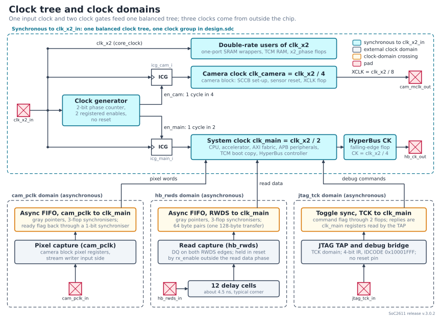
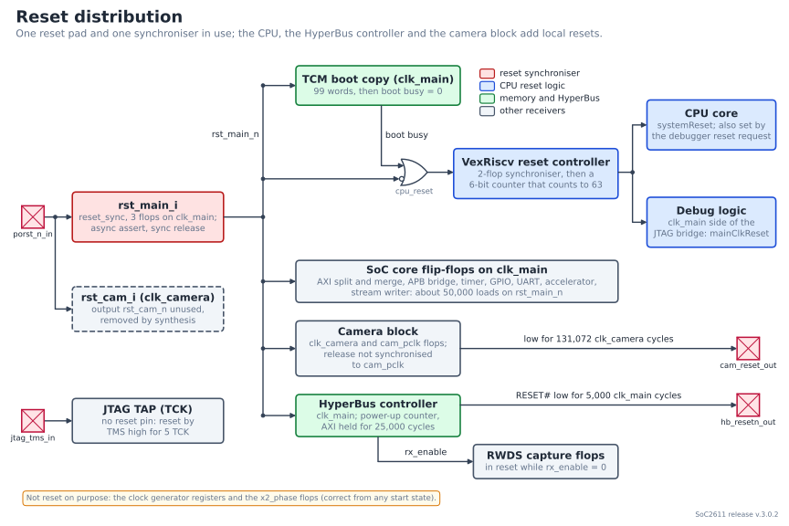

# Clocks and resets

SoC2611 has one clock input, `clk_x2_in`, and no PLL. Two integrated clock gates derive the system clock and the
camera clock from it, so every on-chip clock except three external ones belongs to one balanced clock tree. There is
one reset input, `porst_n_in`, and one reset synchroniser in use. This page describes the clock structure, the
frequencies, the clock-domain crossings and the reset distribution as they are in the RTL of the design repository
and in the timing constraints of the release.

*Figure 1. Clock tree and clock domains. Ratios are given to the input clock; the frequencies are in Table 2.*

## Clock generation

The pad `clk_x2_in` drives the clock tree directly. In `design.sdc` this clock is called `core_clock` and has a
period of 10 ns. In the text below it is called `clk_x2`.

The clock generator `clk_gen_icg` is in `HW/asic/rtl/clk_gate.vhd`. It has a 2-bit phase counter and two registered
enables, all clocked by `clk_x2`. `en_main` is 1 in every other `clk_x2` cycle. `en_cam` is 1 in one cycle out of
four. These registers have no reset on purpose, because only the alignment of the edges matters. In the routed
netlist, synthesis has merged them into three flip-flops whose reset pins are tied high.

Each enable drives an integrated clock gate (ICG). The gate latches the enable while `clk_x2` is low and passes
`clk_x2` while the latched enable is 1. The synthesis flow maps each gate to one `sg13cmos5l_lgcp_1` cell; the
routed netlist has the two cells `icg_main_i/u_icg` and `icg_cam_i/u_icg`.

The results are:

- `clk_main`, the system clock, at half the rate of `clk_x2`. It is high for one `clk_x2` high phase, so its duty
  cycle is 25 %.
- `clk_camera` at a quarter of the rate of `clk_x2`, with a duty cycle of 12.5 %.

Every rising edge of `clk_main` and of `clk_camera` is a rising edge of `clk_x2`, delayed only by one gate. Clock
tree synthesis can therefore build one balanced tree from `clk_x2_in` to all sinks. The comment in `clk_gate.vhd`
gives the reason for this design: a divider flip-flop would make `clk_main` a generated clock rooted at a flip-flop
output, which the clock tree synthesis of OpenROAD does not balance against `clk_x2`. The routed netlist adds root
buffers and chains of delay cells to this tree (instances `CLKROOT_*`, `CLKFIX_*`, `SKEWFIX_*`).

Two more clocks come from flip-flops inside the synchronous domain:

- The camera block divides `clk_camera` by 2 with a toggle flip-flop. The result is the sensor master clock XCLK on
  `cam_mclk_out`, at one eighth of `clk_x2`, with a 50 % duty cycle (`HW/src/soc/peripherals/camera.vhd`).
- The HyperBus controller produces the HyperBus clock CK on `hb_ck_out` from a flip-flop on the falling edge of
  `clk_main` (`HW/asic/rtl/hyperbus/hyperbus_core.vhd`). CK toggles once per `clk_main` cycle, so it runs at a
  quarter of `clk_x2`. The falling edge of `clk_main` comes half a `clk_x2` period after its rising edge, so CK
  changes 5 ns after DQ and RWDS at a 100 MHz input clock. The inverted clock output of the controller is not
  used; the chip drives a single-ended CK.

## Users of each clock

Table 1. Clocks and their users.

| Clock | Made by | Used by |
|---|---|---|
| `clk_x2` | pad `clk_x2_in` | one-port SRAM wrappers in `HW/platform/ihp/`, which make two accesses per system clock cycle on a one-port macro; the TCM RAM (`HW/src/util/ram2r1w.vhd`); the `x2_phase` flip-flops (`HW/src/util/x2_phase.vhd`); the clock generator |
| `clk_main` | `icg_main_i` | CPU, accelerator, AXI split and merge, APB bridge, timer, GPIO, UART, TCM, the `clk_main` side of the stream writer, HyperBus controller |
| `clk_camera` | `icg_cam_i` | camera block control: sensor reset counter, SCCB set-up of the sensor, XCLK toggle flip-flop |
| XCLK, `cam_mclk` in `design.sdc` | toggle flip-flop on `clk_camera` | camera sensor, through `cam_mclk_out` |
| CK, `hb_ck` in `design.sdc` | flip-flop on the falling edge of `clk_main` | HyperRAM, through `hb_ck_out` |
| `cam_pclk` | pad `cam_pclk_in`, from the sensor | camera pixel registers, input side of the stream writer |
| `hb_rwds` | pad `hb_rwds_in`, from the HyperRAM, then 12 delay cells | HyperBus read capture flip-flops, write side of the read FIFO |
| `jtag_tck` | pad `jtag_tck_in`, from the debugger | JTAG TAP and the TCK side of the debug bridge |

The read strobe RWDS and the read data DQ leave the HyperRAM edge aligned. The header of
`HW/asic/rtl/hyperbus/hyperbus_rx.vhd` asks for a delay of about a quarter CK period on RWDS so that the strobe sits
inside the data eye. The RTL does not contain this delay. The routed netlist has it as a chain of 12
`sg13cmos5l_dlygate4sd3_1` cells (`RWDSDLY_1` to `RWDSDLY_12`) between the pad and the RWDS clock tree.
`doc/Interfaces.md` gives about 4.5 ns at the typical corner for this chain.

## Frequencies

The constraints were written for a 100 MHz input clock. The rated input clock at the slow corner is 58.8 MHz, which
gives a 29.4 MHz system clock (`doc/Specification.md`, from `release/v.3.0.2/checks/timing_routed_wires.txt`). The
typical and fast ratings are 91.0 and 128.8 MHz for the input clock.

Table 2. Clock frequencies at the 100 MHz constraint and at the rated slow-corner input clock.

| Clock | Ratio to `clk_x2_in` | At the 100 MHz constraint | At the rated 58.8 MHz, slow corner |
|---|---|---|---|
| `clk_x2` | 1 | 100 MHz, 10 ns | 58.8 MHz, 17.0 ns |
| `clk_main` | 1/2 | 50 MHz, 20 ns | 29.4 MHz, 34.0 ns |
| `clk_camera` | 1/4 | 25 MHz, 40 ns | 14.7 MHz, 68.0 ns |
| XCLK on `cam_mclk_out` | 1/8 | 12.5 MHz, 80 ns | 7.35 MHz, 136 ns |
| CK on `hb_ck_out` | 1/4 | 25 MHz, 40 ns | 14.7 MHz, 68.0 ns |
| RWDS during reads | same rate as CK | 40 ns in `design.sdc` | 14.7 MHz |
| `cam_pclk` | set by the sensor | 41.67 ns, 24 MHz, in `design.sdc` | set by the sensor |
| `jtag_tck` | set by the debugger | 100 ns, 10 MHz, in `design.sdc` | set by the debugger |

The HyperRAM sends RWDS as a strobe with one byte per edge, and the controller transfers one byte per `clk_main`
cycle, so RWDS toggles at the CK rate during a read. `design.sdc` keeps the 40 ns of the 100 MHz case for it.

## Clock domains and crossings

`design.sdc` puts `core_clock`, `clk_main`, `clk_camera`, `cam_mclk` and `hb_ck` into one clock group. Paths between
them are timed as ordinary synchronous paths. The clocks `cam_pclk`, `hb_rwds` and `jtag_tck` each form a group of
their own, declared asynchronous to all others with `set_clock_groups -asynchronous`. `design.sdc` sets no maximum
delay on the synchroniser paths and declares a false path from `porst_n_in`.

Table 3. Every crossing between the clock domains, from the RTL.

| From | To | Signal | Structure | Where |
|---|---|---|---|---|
| `cam_pclk` | `clk_main` | pixel data, 64-bit words | asynchronous FIFO with 32 entries: gray-coded pointers, each through a 3-flop synchroniser `CCD_SYNC` in the receiving clock; data in a dual-clock RAM, mapped to 2-port SRAM macros | `HW/src/soc/axi/axi_stream_write.vhd`, `HW/src/util/afifo2.vhd`, `HW/src/util/afifo.vhd` |
| `clk_main` | `cam_pclk` | stream writer enable, the ready flag of the camera stream | 1-bit `CCD_SYNC`, 3 flops | `axi_stream_write.vhd` |
| `clk_camera` | `cam_pclk` | end of the sensor set-up | no synchroniser; the signal changes once, after the SCCB set-up | `camera.vhd` |
| `hb_rwds` | `clk_main` | HyperBus read data, byte pairs | asynchronous FIFO with 64 entries of 16 bits, one 128-byte transfer; gray-coded pointers through `CCD_SYNC` | `HW/asic/rtl/hyperbus/hyperbus_rx.vhd` |
| `clk_main` | `hb_rwds` | `rx_enable`, the asynchronous reset of the capture flip-flops | no synchroniser; the controller switches it only while RWDS is static | `hyperbus_rx.vhd`, `hyperbus_core.vhd` |
| `jtag_tck` | `clk_main` | debug commands | toggle flag through a 2-flop synchroniser (`FlowCCByToggle`) | `HW/riscv/asic_jtag/riscv.vhd` |
| `clk_main` | `jtag_tck` | debug replies | registers in `clk_main` that the TAP reads in its own clock; the OpenOCD set-up waits before it reads (`readWaitCycles 12`) | `riscv.vhd`, `SoC2611-main/docs/asic_jtag_README.md` |
| pad | `clk_main` | `uart_rx_in` | 3 flip-flops in the UART receiver | `HW/src/soc/peripherals/uart.vhd` |
| pad | `clk_main` | `gpio_in[3:0]`, `spi_miso_in` | one register in the GPIO block | `HW/src/soc/peripherals/gpio.vhd` |
| pad | `clk_main` | `porst_n_in` | reset synchroniser, 3 flip-flops | `HW/asic/rtl/reset_sync.vhd` |

The AXI merge still contains the clock-crossing FIFOs that served the DDR controller clock of the FPGA design. On this
chip both of their sides run on `clk_main`, because the chip top connects the memory-side clock `SDRAM_clk` to
`clk_main`. They are not crossings here.

*Figure 2. Reset distribution.*

## Reset

`porst_n_in` is an active-low, asynchronous reset input. It feeds the reset synchroniser `rst_main_i`
(`HW/asic/rtl/reset_sync.vhd`, 3 stages). The synchroniser asserts its output `rst_main_n` at once and releases it
after three rising edges of `clk_main`. In the routed netlist it is three flip-flops whose reset pins connect to
`porst_n_in`. `rst_main_n` drives a buffer tree with about 50,000 loads, according to the README of the public
repository.

The chip top also has a second synchroniser, `rst_cam_i`, on `clk_camera`. Its output `rst_cam_n` is not connected
to anything, and synthesis removed it; the routed netlist has no `rst_cam_i`.

Table 4. Where the resets go.

| Receiver | Reset | Notes |
|---|---|---|
| AXI split and merge, APB bridge, timer, GPIO, UART, accelerator, stream writer | `rst_main_n`, through the `clk_reset` port of `soc_base` | the stream writer uses it on both clock sides |
| TCM boot copy | `rst_main_n` | after release it copies 99 words and then lets the CPU go (`HW/src/soc/tcm.vhd`) |
| CPU | `cpu_reset` = not `rst_main_n`, or the boot copy is busy | the VexRiscv passes it through its own 2-flop synchroniser and holds the reset until a 6-bit counter reaches 63 |
| CPU core inside the VexRiscv | `resetCtrl_systemReset` | also set by the reset request of the debugger |
| Debug logic, `clk_main` side of the JTAG bridge | `resetCtrl_mainClkReset` | not reset by the debugger reset |
| HyperBus controller | `rst_main_n` | after release it holds `hb_resetn_out` low for 5,000 `clk_main` cycles and accepts no AXI request for 20,000 cycles more |
| HyperBus read capture flip-flops | `rx_enable` from the controller | held in reset outside the read data phase |
| Camera block | `rst_main_n` | used by its `clk_camera` and its `cam_pclk` flip-flops; the release is not synchronised to `cam_pclk`. It holds `cam_reset_out` low for 131,072 `clk_camera` cycles |
| JTAG TAP | none | no reset pin; TMS high for 5 TCK cycles resets it |
| Clock generator, `x2_phase` flip-flops | none | correct from any start state |

Table 5. The local reset times at the two clock rates.

| Local reset | Length | At the 100 MHz constraint | At the rated 58.8 MHz |
|---|---|---|---|
| `hb_resetn_out` low | 5,000 `clk_main` cycles | 100 µs | 170 µs |
| no AXI request accepted, counted from the release of `rst_main_n` | 25,000 `clk_main` cycles | 500 µs | 850 µs |
| `cam_reset_out` low | 131,072 `clk_camera` cycles | 5.24 ms | 8.92 ms |

The HyperBus wait comes from the generic `HB_POWERUP_CYCLES` = 20000 of the chip top and the constants of
`HW/asic/rtl/hyperbus/hyperbus_axi.vhd`. The CPU reset logic is in `HW/riscv/asic_jtag/riscv.vhd`; the reset port of
the debugger request (`debug_resetOut`) is left open in `HW/src/soc/soc_base.vhd`, so a debugger reset does not reach
the peripherals.

## Sources

- Design repository: `HW/asic/rtl/clk_gate.vhd`, `HW/asic/rtl/reset_sync.vhd`, the chip top `soc2611_chip_top` in
  `HW/asic/rtl/`, `HW/asic/rtl/hyperbus/hyperbus_core.vhd`, `hyperbus_rx.vhd`, `hyperbus_axi.vhd`
- Design repository: `HW/src/soc/soc_base.vhd`, `HW/src/soc/tcm.vhd`, `HW/src/soc/peripherals/camera.vhd`,
  `uart.vhd`, `gpio.vhd`, `HW/src/soc/axi/axi_stream_write.vhd`, `axi_merge.vhd`
- Design repository: `HW/src/util/afifo.vhd`, `afifo2.vhd`, `x2_phase.vhd`, `ram2r1w.vhd`,
  `HW/platform/asic/CCD_SYNC.vhd`, `HW/platform/ihp/DPRAM.vhd`, `HW/riscv/asic_jtag/riscv.vhd`
- `SoC2611-main/constraints/design.sdc`
- `SoC2611-main/docs/asic_jtag_README.md`
- `doc/Specification.md`, `doc/Interfaces.md`
- `release/v.3.0.2/checks/timing_routed_wires.txt`
- `release/v.3.0.2/netlist/SoC2611.v.gz` (clock gate cells, clock generator flip-flops, `RWDSDLY_*` delay chain,
  reset synchroniser, absence of `rst_cam_i`)
- `README.md` of the public repository (loads of the system reset)
