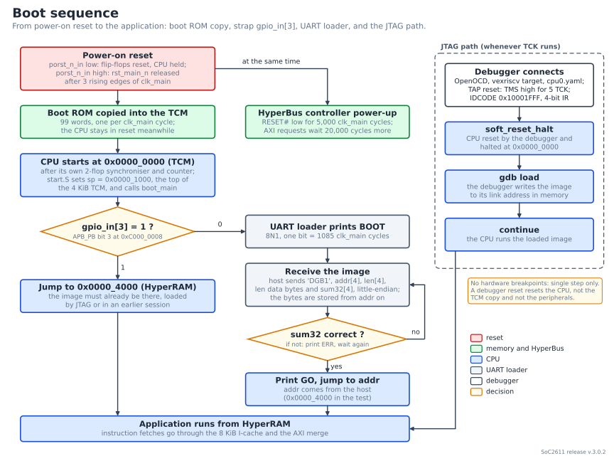
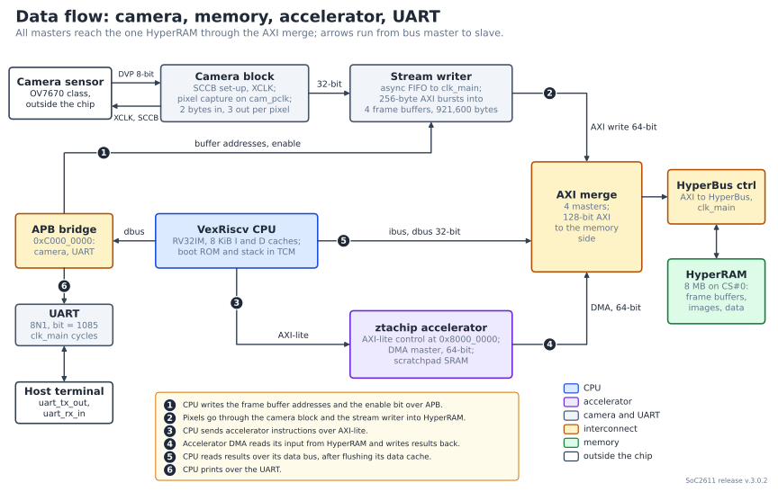

# Boot and data flow

This page describes how SoC2611 starts after power-on and how data moves through the chip in a camera application.
The boot path runs from the reset pad through a hardware copy of the boot ROM into the tightly coupled memory (TCM)
to either a direct jump into the external HyperRAM or a UART loader. A debugger can take the same chip over JTAG.
The data path runs from the camera pads through the camera block and the stream writer into frame buffers in
HyperRAM, and from there to the accelerator, the CPU and the UART. Everything here comes from the RTL and the boot
ROM source in the design repository and from the register map in `doc/RegisterMap.md`.

## Memory map used at boot

Table 1. Address regions as the CPU sees them.

| Address | Region | Basis |
|---|---|---|
| `0x0000_0000` to `0x0000_0FFF` | TCM, 4 KiB: boot ROM image and its stack | `tcm_depth_c` = 12 in `HW/asic/rtl/config.vhd`; address decode in `HW/src/soc/soc_base.vhd`; one `RM_IHPSG13_2P_1024x32` macro in the routed netlist |
| `0x0000_1000` and up, below `0x4000_0000` (data) or `0x8000_0000` (instructions) | HyperRAM through the AXI merge and the HyperBus controller | `soc_base.vhd`; the controller ignores address bits 23 and up, so the 8 MB device repeats |
| `0x0000_4000` | start of the application image, `APP_ENTRY` | `HW/asic/fw/bootrom/boot.c`, `HW/asic/fw/link.ld` |
| `0x4000_0000` to `0x7FFF_FFFF` (data only) | read-only window into the accelerator scratchpad SRAM | `soc_base.vhd`, `HW/src/top/ztachip.vhd` |
| `0x8000_0000` | accelerator host registers, AXI-lite | `doc/RegisterMap.md` section 3 |
| `0xC000_0000` | APB peripherals | `doc/RegisterMap.md` section 2 |

*Figure 1. Boot sequence.*

## Boot sequence

1. **Power-on reset.** While `porst_n_in` is low, the reset tree `rst_main_n` holds the flip-flops of the SoC in
   reset. The TCM copy logic starts in its busy state, which keeps the CPU in reset. When `porst_n_in` goes high,
   `rst_main_n` is released after three rising edges of `clk_main` (see
   [03_clocks_and_resets.md](03_clocks_and_resets.md)).
2. **Boot ROM copy.** The TCM (`HW/src/soc/tcm.vhd`) writes the boot ROM image into its RAM, one 32-bit word per
   `clk_main` cycle. The image is 99 words, 396 bytes (`HW/asic/rtl/boot_rom_pkg.vhd`, generated from
   `HW/asic/fw/bootrom/` by `build.sh`). The CPU reset input is `cpu_reset` = not `rst_main_n`, or the copy is busy.
3. **HyperBus power-up, at the same time.** After the release of `rst_main_n`, the HyperBus controller holds the
   HyperRAM reset `hb_resetn_out` low for 5,000 `clk_main` cycles. It then accepts no AXI request for 20,000 more
   cycles (`HW/asic/rtl/hyperbus/hyperbus_axi.vhd`, `HB_POWERUP_CYCLES` = 20000 in the chip top). A HyperRAM access
   that comes earlier waits. The whole wait is 500 µs at a 50 MHz system clock and 850 µs at 29.4 MHz.
4. **CPU start.** The VexRiscv synchronises its reset with two flip-flops and holds it until a 6-bit counter
   reaches 63 (`HW/riscv/asic_jtag/riscv.vhd`). Its reset vector is `0x0000_0000`, the start of the TCM.
   `HW/asic/fw/bootrom/start.S` sets the stack pointer to `0x0000_1000`, the top of the 4 KiB TCM, and calls
   `boot_main`.
5. **Boot strap.** `boot_main` reads `APB_PB` at `0xC000_0008`. Bit 3 is the pad `gpio_in[3]`, sampled by one
   register in the GPIO block.
   - Bit 3 = 1: the ROM jumps to `0x0000_4000` at once and prints nothing. The image must already be in HyperRAM,
     for example loaded by JTAG or in an earlier session. The first instruction fetch from HyperRAM waits for the
     end of the HyperBus power-up.
   - Bit 3 = 0: the UART loader runs.
6. **UART loader.** The loader prints `BOOT` and waits for a header. Then it stores the image bytes, checks the sum
   and jumps. Table 2 gives the protocol, from `boot.c`. On a wrong sum it prints `ERR` and waits for the next
   header. The jump address is the one the host sends; the test sends its image to `0x0000_4000`.
7. **Application.** The application runs from HyperRAM. Its instruction fetches go through the 8 KiB instruction
   cache and the AXI merge.

Table 2. UART loader protocol, all fields little-endian.

| Direction | Content |
|---|---|
| chip to host | `BOOT` and a line feed, at start |
| host to chip | the 4 characters `DGB1`, then `addr` (4 bytes), `len` (4 bytes), `len` data bytes, `sum32` (4 bytes) |
| chip to host | `GO` and a line feed, then a jump to `addr`; or `ERR` and a line feed if `sum32` is not the 32-bit sum of the data bytes |

The UART frame is 8N1. One bit lasts 1085 `clk_main` cycles, because the design constant assumes a 125 MHz system
clock and 115,200 baud. Table 3 gives the resulting bit rates from `doc/RegisterMap.md`.

Table 3. UART bit rate of the loader.

| System clock | Bit rate |
|---|---|
| 50 MHz, at the 100 MHz constraint | 46,080 baud |
| 29.4 MHz, rated slow corner | about 27,100 baud |

### The JTAG path

The VexRiscv has a JTAG debug port with a 4-bit instruction register and the IDCODE `0x10001FFF`
(`SoC2611-main/docs/asic_jtag_README.md`). The README gives this sequence for OpenOCD with the `vexriscv` target and
`cpu0.yaml`:

- The TAP has no reset pin. OpenOCD resets it with TMS high for 5 TCK cycles.
- `soft_reset_halt` resets the CPU and halts it at the reset vector `0x0000_0000`, in the boot ROM.
- In gdb, `load` writes the image into memory and `continue` runs it.

The TAP itself works whenever TCK runs. Its commands reach the CPU through the `clk_main` side of the debug bridge,
which leaves reset together with the CPU. A debugger reset resets the CPU core only. The port `debug_resetOut` is
left open in `HW/src/soc/soc_base.vhd`, so the TCM copy and the peripherals are not reset by it. The CPU has no
hardware breakpoints (`hardwareBreakpointCount` = 0), so boot ROM code can only be single-stepped.

Exceptions: the trap vector of the CPU is fixed at `0x8000_0020`, inside the accelerator register window, and `ecall`
does not trap. After an exception only a reset or JTAG brings the CPU back (`doc/RegisterMap.md` section 1).

### What was simulated

- UART loader: `SoC2611-main/verification/sim/cocotb_bootldr.log` shows `BOOT`, an image of 112 bytes sent to
  `0x4000`, `GO` and `HELLO` from the loaded program. Its compile list shows the generic ASIC top with a DDR
  memory model, not the chip top with the HyperBus controller.
- Strap high: the simulations of the routed netlist drive `gpio_in` = `0x9`, so bit 3 is 1, and boot from a HyperRAM
  model on the HyperBus pads (`SoC2611-main/testbenches/gate_level/tb_chip_gl.sv`,
  `release/v.3.0.2/checks/simulation_summary.txt`).
- JTAG: no simulation in the release drives the TAP. The firmware suite in the README of the JTAG core ran with the
  JTAG pins unconnected.

*Figure 2. Data flow. The numbers are the steps below.*

## Data flow

1. **The CPU sets up the stream writer over APB.** It writes the four frame buffer addresses to `APB_CAMERA_BUFFER`
   at offsets `0x14` to `0x20` and then bit 0 of `APB_CAMERA_ENABLE` at `0x0C`. The enable restarts the writer at
   buffer 0. `APB_CAMERA_CURR_FRAME` at `0x10` returns the index of the buffer being written
   (`HW/src/soc/axi/axi_stream_write.vhd`).
2. **Pixels go into HyperRAM.**
   - The camera block (`HW/src/soc/peripherals/camera.vhd`) holds `cam_reset_out` low for 131,072 `clk_camera`
     cycles. It then writes a fixed table of 56 sensor registers over SCCB, to the device address `0x42`. The capture
     test gives about 721,000 `clk_camera` cycles for reset and set-up together (`HW/asic/fw/capture.c`).
   - Capture starts at the first rising edge of `cam_vs_in` after the set-up has finished and the stream writer is
     enabled. While `cam_hs_in` is high, the block takes two bytes per pixel on `cam_pclk`. It keeps three 4-bit
     colour fields, writes each as one byte with a zero low half, and packs the three bytes per pixel into 32-bit
     words. A frame is 640 pixels by 480 rows.
   - The stream writer joins two words into 64 bits in the `cam_pclk` domain and moves them to `clk_main` through an
     asynchronous FIFO of 32 entries, then through a FIFO of 256 entries. It writes AXI bursts of 32 beats of 8
     bytes, 256 bytes per burst. After 921,600 bytes, one frame of 640 x 480 x 3 bytes, it moves to the next of the
     four buffers. If the FIFO is full, it drops the next 921,600 bytes so that the writes stay aligned to the
     frame buffers.
3. **The CPU starts the accelerator over AXI-lite.** The host registers are at `0x8000_0000` (`doc/RegisterMap.md`
   section 3). `REG_DDR_BAR` sets the main-memory base for accelerator transfers, and `REG_DP_RUN` starts a
   data-plane program. Only the readable registers answer a read; reading a write-only register stalls the CPU
   (`SoC2611-main/docs/ASIC_PORT.md` section 7).
4. **The accelerator reads and writes HyperRAM by DMA.** Its AXI master is 64 bits wide and is one of the four
   masters of the AXI merge (`HW/src/soc/soc_base.vhd`). The data plane moves tensor data between external memory
   and the internal memories of the accelerator (`SoC2611-main/docs/HardwareDesign.md`). A frame buffer is ordinary
   HyperRAM, so the accelerator can read a captured frame from it.
5. **The CPU reads the results.** It reads HyperRAM through its data bus and the AXI merge. The stream writer and
   the accelerator write to HyperRAM behind the CPU data cache. The capture test flushes the data cache before it
   reads the frame buffer (`FLUSH_DATA_CACHE`, instruction word `0x500F`, in `HW/asic/fw/capture.c`). The CPU can
   also read the accelerator status registers and, through the window at `0x4000_0000`, the scratchpad SRAM.
6. **The CPU prints over the UART.** It waits for `APB_UART_WRITE_AVAIL` at `0x48` and writes each byte to
   `APB_UART_WRITE` at `0x40`.

Table 4. The masters of the AXI merge (`HW/src/soc/axi/axi_merge.vhd`, `HW/src/soc/soc_base.vhd`).

| Master | Width | Direction |
|---|---|---|
| accelerator DMA | 64 bits | read and write |
| stream writer | 64 bits | write |
| CPU instruction bus | 32 bits | read |
| CPU data bus | 32 bits | read and write |

The merge drives one 128-bit AXI port into the HyperBus controller. The controller handles one transaction at a time.
When reads and writes are both waiting, they take turns. It cuts each burst into HyperBus transfers inside 128-byte
windows and moves one byte per `clk_main` cycle in the data phase. The HyperRAM uses a fixed initial latency of 6
clocks, doubled (`hyperbus_axi.vhd`, `hyperbus_core.vhd`).

The video read DMA registers at APB offsets `0x24` to `0x38` have no slave in this configuration, because the VGA
output is disabled (`vga_enabled_c` = FALSE). An access there gets no ready signal, so the APB bridge and the CPU wait
(`HW/src/soc/soc_base.vhd`, `HW/src/soc/axi/axi_apb_bridge.vhd`).

### What was simulated

- Camera path, pad to pad: the simulation of the routed netlist sends frames on the camera pads. The capture test
  waits for the bursts in HyperRAM, reads them back and prints a checksum on the UART. Result: pass, 4,842 memory
  transactions and 408,245 bytes from the camera pads (`release/v.3.0.2/checks/simulation_summary.txt`).
- Accelerator: the firmware suite reads the host registers of the accelerator (tests T01 and T06). No result in
  the release runs an accelerator program; `SoC2611-main/docs/ASIC_PORT.md` section 7 says the suite does not run
  PCORE kernels.

## Sources

- Design repository: `HW/asic/fw/bootrom/boot.c`, `start.S`, `link.ld`, `build.sh`, `HW/asic/rtl/boot_rom_pkg.vhd`,
  `HW/asic/rtl/config.vhd`, the chip top `soc2611_chip_top` in `HW/asic/rtl/`
- Design repository: `HW/src/soc/tcm.vhd`, `HW/src/soc/soc_base.vhd`, `HW/src/soc/axi/axi_split.vhd`,
  `axi_split_read.vhd`, `axi_merge.vhd`, `axi_stream_write.vhd`, `axi_apb_bridge.vhd`
- Design repository: `HW/src/soc/peripherals/camera.vhd`, `gpio.vhd`, `uart.vhd`, `HW/src/top/ztachip.vhd`,
  `HW/src/ztachip_pkg.vhd` (APB offsets)
- Design repository: `HW/asic/rtl/hyperbus/hyperbus_axi.vhd`, `hyperbus_core.vhd`, `HW/riscv/asic_jtag/riscv.vhd`
- Design repository: `HW/asic/fw/link.ld`, `HW/asic/fw/capture.c`
- `doc/RegisterMap.md`, `doc/Interfaces.md`
- `SoC2611-main/docs/asic_jtag_README.md`, `SoC2611-main/docs/ASIC_PORT.md` (section 7),
  `SoC2611-main/docs/HardwareDesign.md`
- `SoC2611-main/verification/sim/cocotb_bootldr.log`, `SoC2611-main/testbenches/gate_level/tb_chip_gl.sv`
- `release/v.3.0.2/checks/simulation_summary.txt`
- `release/v.3.0.2/netlist/SoC2611.v.gz` (TCM macro)
