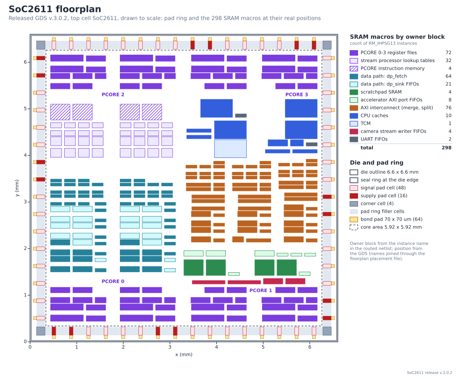
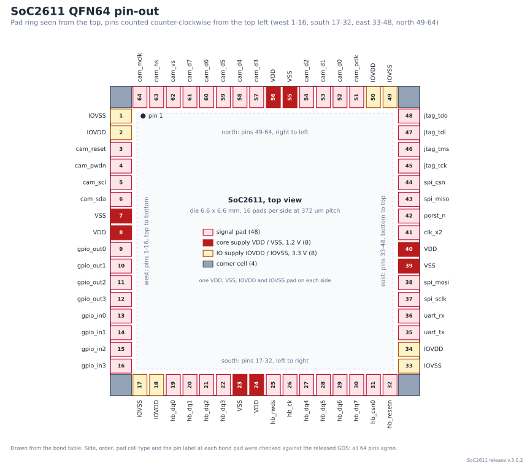
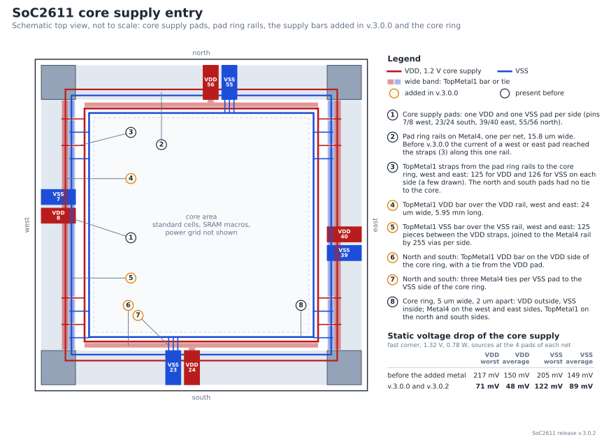

# Physical design

This page shows SoC2611 as it is laid out in release v.3.0.2: the floorplan drawn from the released GDS, the
QFN64 pin-out, and the way the core supply enters the chip. The floorplan and the pin-out are read from the GDS
file `release/v.3.0.2/gds/SoC2611.gds.gz`, top cell `SoC2611`. The supply figure is a schematic.

## Floorplan

*The die drawn to scale from the released GDS, with every SRAM macro at its real position.*

| Item | Value | Source |
|---|---|---|
| Die | 6600 x 6600 um | `doc/Specification.md`, GDS top cell |
| Seal ring | at the die edge; its drawn metal lies 25.0 to 36.4 um from the edge | `doc/Specification.md`, GDS cell `sealring` |
| Bond pads | 64 pads of 70 x 70 um, 70 to 140 um from the edge, centres at 372 um pitch | `bond_table.csv`, GDS |
| Pad ring | 64 pad cells and 4 corner cells, 180 um deep, 140 to 320 um from the edge; filler cells close the gaps | `padring_qfn64.json`, GDS |
| Core | 5920 x 5920 um, 340 um margin to the die edge | `doc/Specification.md` |
| SRAM | 298 RM_IHPSG13 macros, 214 KiB, about 12.9 mm2 | `doc/Specification.md`, `inventory.md` |
| Standard cells | about 290k after synthesis (about 6.2 mm2), about 335k after place and route | `doc/Specification.md` |

The macros lie between 440.2 um and 6159.7 um in x and y: 100 um inside the core edge on all four sides. 145 of
them are placed in orientation R0 and 153 mirrored (MX).

### Owner blocks of the macros

The GDS holds the macros without names. The owner block of each macro comes from its instance name in the routed
netlist. The names were joined to the GDS positions through the floorplan placement file
`SoC2611-main/Flow/floorplan/H12_cpueast.pl`, which gives name, position and orientation of every macro. 296 of
the 298 macros sit exactly where that file puts them. The other two are `dp_fetch` 64x16 slices that lie 63.36 um
east of their place in the file; their top right corners, x 1630.88 um and 3120.72 um, are the two corners named
in the release note of v.3.0.2. The macro counts per type agree with `inventory.md`. Areas are those of the macro
outlines in the GDS.

| Owner block | Instance names contain | Macros | Area, mm2 | Where on the die |
|---|---|---:|---:|---|
| PCORE register files | `core_i/gen_cell[0]_cell_i/gen_reg[N]_gen1_pcore_i` | 72 | 4.15 | south edge: PCORE 0 west, PCORE 1 east; north edge: PCORE 2 west, PCORE 3 east |
| Stream processor lookup tables | `core_i/gen_stream`, `core_i/gen_stream_1` | 32 | 1.14 | north-west, y 4.0 to 4.7 mm |
| PCORE instruction memory | `core_i/instr_i/rom_i` | 4 | 0.56 | north-west, y 4.8 to 5.1 mm |
| Data path, `dp_fetch` | `dp_1_i/dp0_i/dp_fetch_1_i` | 64 | 1.46 | west half, y 1.5 to 3.5 mm |
| Data path, `dp_sink` FIFOs | `dp_1_i/dp0_i/dp_sink1_i` to `dp_sink3_i` | 21 | 0.95 | west half, among the `dp_fetch` macros |
| Scratchpad | `ztachip_inst/sram_i` | 4 | 0.56 | east half, y 1.4 to 1.8 mm |
| Accelerator AXI port FIFOs | `ztachip_inst/axilite_i`, `ztachip_inst/ddr_rx_i` | 8 | 0.23 | next to the scratchpad |
| AXI interconnect | `axi_merge_inst`, `axi_split_dbus_i`, `axi_split_ibus_i` | 76 | 2.07 | east half, y 2.1 to 3.9 mm |
| CPU caches | `gen_cpu_jtag_cpu_inst/system_cpu` | 10 | 1.31 | east half, y 4.1 to 5.2 mm |
| TCM | `tcm_i` | 1 | 0.26 | below the caches |
| Camera stream writer FIFOs | `gen_vstream_wr_axi_stream_write_inst` | 4 | 0.20 | east half, y 1.2 to 1.4 mm |
| UART FIFOs | `uart_inst` | 2 | 0.04 | among the CPU caches |
| **Total** | | **298** | **12.94** | |

The TCM is one RM_IHPSG13_2P_1024x32 macro, 4 KiB.

### How the floorplan was made

The floorplan notes in `SoC2611-main/Flow/floorplan/` and the status files of 7 to 9 November describe it:

- The macros were placed by hand and grouped by the logic that drives them. A first floorplan had a column of 28
  SRAMs 26 um from the pad ring, and its routing shorts led to the hand floorplan.
- Macro rows face standard-cell strips of 60 to 120 um, across which the macro pins are reached. All signal pins
  of an RM_IHPSG13 macro are on its south edge in Metal2, and Metal1 to Metal4 are blocked over the macro.
- Routing highways 180 um wide run between the macro columns, and every macro keeps at least 100 um from the pad
  ring.
- No wire can cross a macro from north to south: Metal1 to Metal4 are blocked inside it and TopMetal1, the only
  layer above, runs east to west. Nets of logic split by a macro therefore need channels around it.
- Floorplan H12 opened a north-south passage through the CPU block by moving the two 1024x32 caches to the east
  margin and two 64x22 tag macros to the west. H13 added placement blockages on all 146 dead spaces of the macro placement: in H12, 98 of the 112 nets that
  crossed a macro had a pin in such a space. The macro positions in the GDS are those of H12, apart from the two
  slices named above.
- The release of v.3.0.0 keeps the floorplan, the macros and the pads of v.2.4.0.

## Pin-out

*Pins counted counter-clockwise from the top left: west 1 to 16, south 17 to 32, east 33 to 48, north 49 to 64.*

Each side carries one VDD, one VSS, one IOVDD and one IOVSS pad: 48 signal pads and 16 supply pads. The bond pads
sit at 372 um pitch, the first centre 510 um from the corner of the die and 105 um from its edge.

The pin list was checked four ways, and all 64 pins agree:

- `doc/Datasheet.md` against `SoC2611-main/constraints/bond_table.csv`: pin, side, signal and pad cell.
- `SoC2611-main/constraints/padring_qfn64.json`: the order on each side.
- The pin labels in the GDS: one text per bond pad on the TopMetal1 text layer, at the coordinates of the bond
  table, `<signal>_PAD` for signals and the net name for supplies.
- The pad cells in the GDS: the cell type at each bond pad position equals the pad cell of the bond table.

| Pad cell | Pads |
|---|---:|
| sg13cmos5l_IOPadIn | 22 |
| sg13cmos5l_IOPadOut4mA | 15 |
| sg13cmos5l_IOPadInOut16mA | 9 |
| sg13cmos5l_IOPadOut16mA | 1 |
| sg13cmos5l_IOPadInOut4mA | 1 |
| sg13cmos5l_IOPadVdd, IOPadVss, IOPadIOVdd, IOPadIOVss | 4 each |

## Core supply

*Schematic, not to scale. Numbered items are explained in the figure; orange circles mark the metal added in v.3.0.0.*

Each side has one core supply pad per net. Before v.3.0.0 only the west and east pads were tied to the power
grid, over TopMetal1 straps that run from the pad ring to the core ring, and the current of a pad reached those
straps along one Metal4 rail of the pad ring, 15.8 um wide. The north and south pads were not tied to the core at
all.

Release v.3.0.0 added 0.762 mm2 of TopMetal1 in 256 boxes and 516 vias. No signal wire, cell or pad moved.

- West and east, VDD: a TopMetal1 bar over the VDD rail of the pad ring, 24 um wide and 5.95 mm long.
- West and east, VSS: a TopMetal1 bar over the VSS rail in 125 pieces between the VDD straps, each piece joined
  to the Metal4 rail by vias, 255 vias per side.
- North and south, VDD: a TopMetal1 bar on the VDD side of the core ring and a tie from the supply pad to it.
- North and south, VSS: three Metal4 ties per pad from the pad to the VSS side of the core ring.

In the GDS the core ring is 5 um wide with 2 um between the two rings: VDD outside, VSS inside, Metal4 on the west
and east sides and TopMetal1 on the north and south sides. Each of the west and east sides has 125 straps from the
VDD rail to the VDD ring and 126 from the VSS rail to the VSS ring.

Static voltage drop, OpenROAD PDNSim on the routed layout, fast corner, 1.32 V, 0.78 W total power, sources at the
four supply pads of each net:

| Layout | VDD worst | VDD average | VSS worst | VSS average |
|---|---:|---:|---:|---:|
| before the added metal | 217 mV | 150 mV | 205 mV | 149 mV |
| v.3.0.0 and v.3.0.2 | 71 mV | 48 mV | 122 mV | 89 mV |

An analysis with ideal sources on the core power straps does not see the pad ring rails: it shows 17 mV and 27 mV
for the layout before the added metal. v.3.0.2 differs from v.3.0.0 only by two row filler cells, so the
numbers carry over.

## Sources

- `release/v.3.0.2/gds/SoC2611.gds.gz`: die, seal ring, pad cells, bond pads, pin labels, macro positions, supply
  metal, read with the KLayout Python module.
- `release/v.3.0.2/netlist/SoC2611.v.gz`: macro instance names.
- `release/v.3.0.2/checks/supply_drop.txt`, `release/v.3.0.2/checks/changes_from_v3.0.0.txt`,
  `release/v.3.0.2/ReleaseNote.md`, `release/v.3.0.0/ReleaseNote.md`.
- `doc/Specification.md`, `doc/Datasheet.md`.
- `SoC2611-main/constraints/bond_table.csv`, `SoC2611-main/constraints/padring_qfn64.json`.
- `SoC2611-main/synthesis/inventory.md`.
- `SoC2611-main/Flow/floorplan/H12_cpueast.pl`, `SoC2611-main/Flow/floorplan/ROUTING_PROBLEM_H4.md`,
  `SoC2611-main/Flow/floorplan/ROUTING_PROBLEM_H10.md`.
- `STATUS_2026-11-07.md`, `STATUS_2026-11-08.md`, `STATUS_2026-11-09.md`.
