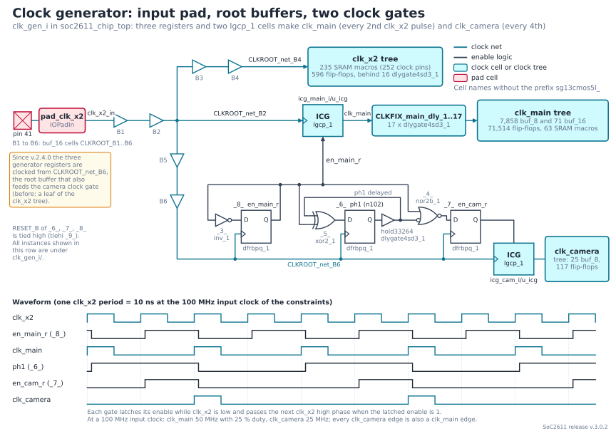
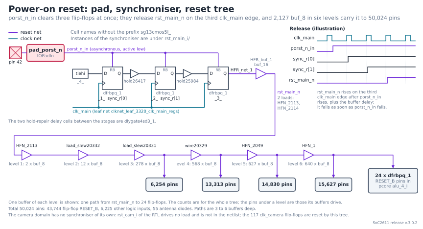
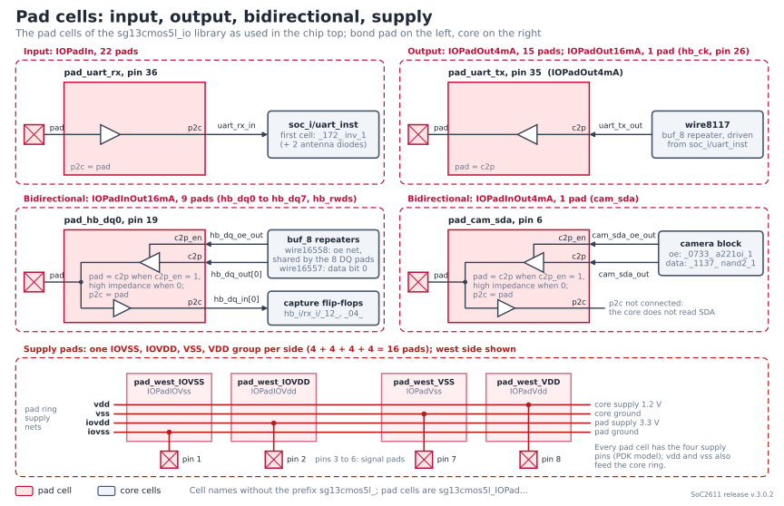
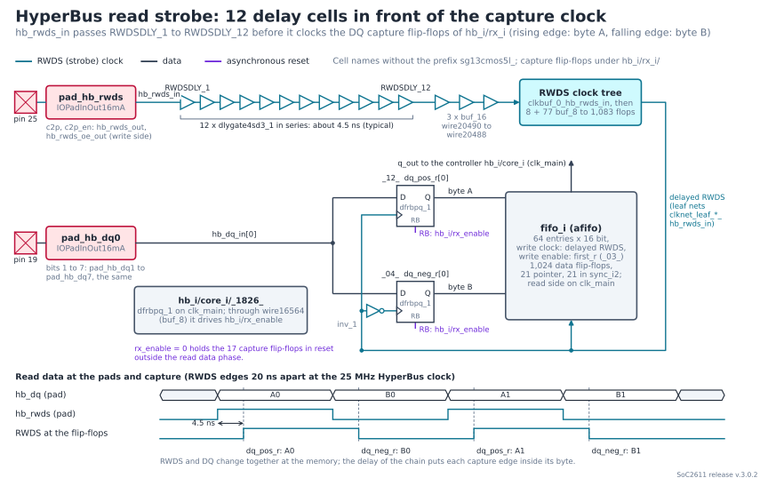
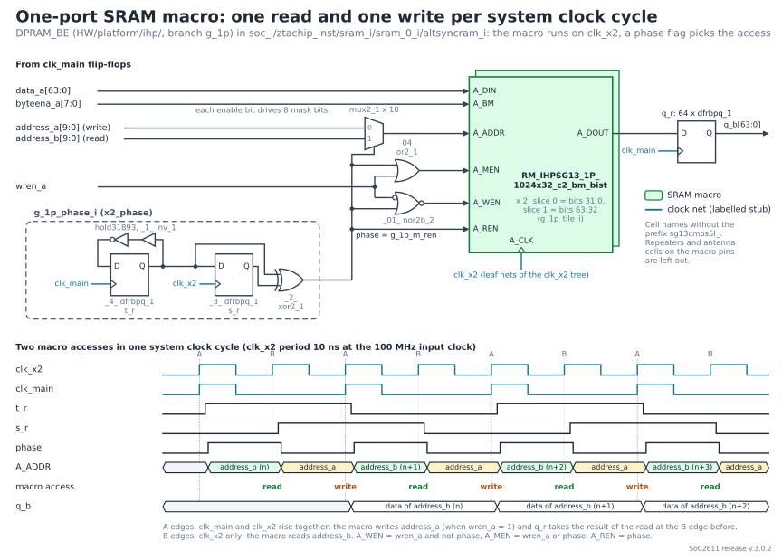
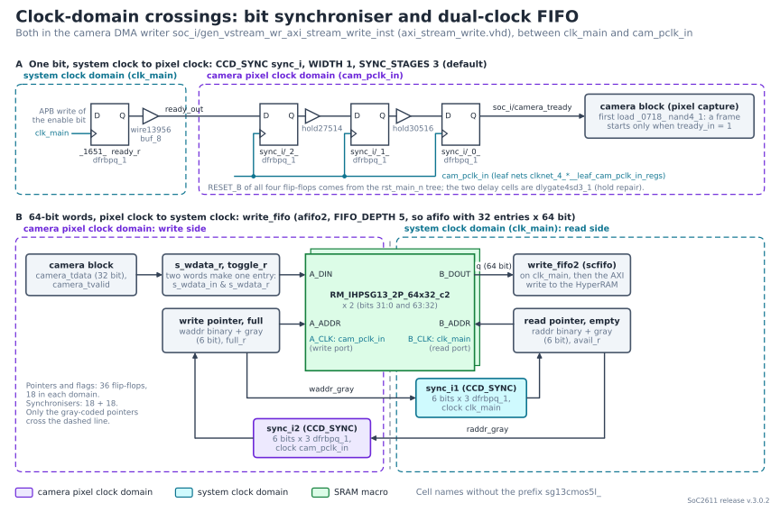
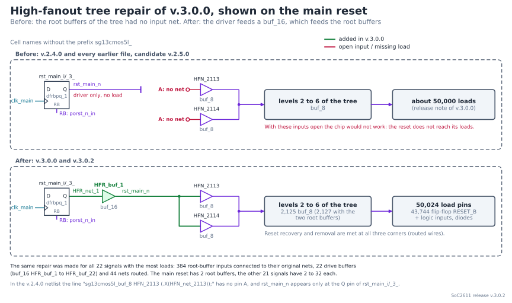
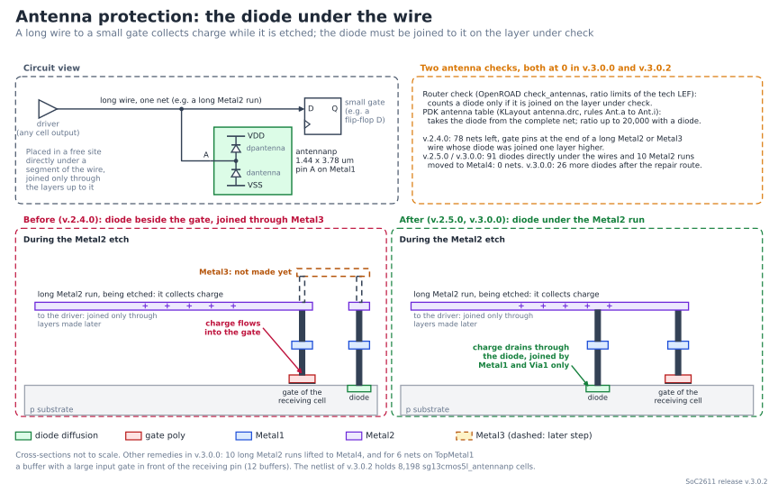

# SoC2611 schematics of key circuits

This document shows eight circuits of the SoC2611 chip at cell level. Every cell, instance and net in the figures
was read from the routed gate-level netlist of release v.3.0.2 (`release/v.3.0.2/netlist/SoC2611.v.gz`). The
behaviour comes from the RTL of the design repository, and the history comes from the release notes. Cell names
are given without the library prefix `sg13cmos5l_`, so `dfrbpq_1` means `sg13cmos5l_dfrbpq_1`. Instance names are
written as in the netlist, with `/` between hierarchy levels and without the leading backslash of escaped names.
The counts were taken from the netlist by following each net through buffers to its loads.

## 1. Clock generator and clock gates

*The clock generator clk_gen_i: clk_main is every second clk_x2 pulse, clk_camera every fourth.*

The figure shows the clock input pad `pad_clk_x2` (IOPadIn, pin 41), the six `buf_16` root buffers `CLKROOT_B1` to
`CLKROOT_B6`, the three generator registers (`dfrbpq_1`) with their enable logic, and the two integrated clock gates
(`lgcp_1`). The enable logic is one `inv_1`, one `xor2_1`, one `nor2b_1` and one `dlygate4sd3_1` hold delay. A
`tiehi` holds the reset pins of the three registers high. Sources: `HW/asic/rtl/clk_gate.vhd` (entities `clk_gate`
and `clk_gen_icg`), the chip top in `HW/asic/rtl/`, the netlist, and the release note of v.2.4.0.

The input clock `clk_x2` has no PLL behind it. Each clock gate latches its enable while `clk_x2` is low. It passes
the next high phase of `clk_x2` when the latched enable is 1. Register `_8_` (`en_main_r`) toggles on every
`clk_x2` edge, so `icg_main_i/u_icg` passes every second pulse. That is `clk_main`, the system clock: 50 MHz at the
100 MHz input clock of the constraints, with 25 % duty. Register `_6_` is the second phase bit. Register `_7_`
(`en_cam_r`) is 1 in one cycle out of four, so `icg_cam_i/u_icg` makes `clk_camera` at 25 MHz. Every `clk_camera`
edge is also a `clk_main` edge. The RTL has four registers, but `ph0_r` always equals `en_main_r`; the netlist has
no separate register for it, so three remain.

Because both clocks come from `clk_x2` through one gate each, all their rising edges are `clk_x2` rising edges. The
clock tree tool can then balance one tree from the pad. The camera master clock `cam_mclk_out` is a toggle
flip-flop (`soc_i/gen_camera_camera_inst/_1577_`) on `clk_camera`. It runs at half the camera clock: 12.5 MHz at a
100 MHz input clock.

Since v.2.4.0 the three generator registers are clocked from `CLKROOT_net_B6`. That root buffer also feeds the
camera clock gate. Before, the registers hung on a leaf of the `clk_x2` tree, 6.4 / 9.1 / 14.0 ns after the pad
(fast / typical / slow), while the gates sit at the root. The enable of the system clock gate then had only what
was left of one 10 ns cycle. That path limited the typical corner in v.2.3.0.

Two delay chains sit in the clock paths. `CLKFIX_main_dly_1` to `CLKFIX_main_dly_17` (17 `dlygate4sd3_1`) are
between the system clock gate and its tree. `CLKFIX_x2reg_dly_1` to `CLKFIX_x2reg_dly_16` (16 `dlygate4sd3_1`) are
in front of the subtree of the `clk_x2` flip-flops. The flow script that added them gives the reason: the SRAM
clock must not arrive later than the flop clock, and the phase flag of figure 5 must not change before the macro
has sampled it. A third chain, `SKEWFIX_dly_1` to `SKEWFIX_dly_7`, hangs on `CLKROOT_net_B4`; its output has no
load.

| Clock tree | Root in the figure | Flip-flops | SRAM macros (clock pins) | Buffers |
|---|---|---:|---:|---|
| `clk_main` | `icg_main_i/u_icg`, then `CLKFIX_main` | 71,514 | 63 (88) | 7,858 `buf_8`, 71 `buf_16` |
| `clk_x2` | `CLKROOT_net_B4` | 596 | 235 (252) | 313 `buf_8`, 58 `buf_16`, 23 `dlygate4sd3_1` |
| `clk_camera` | `icg_cam_i/u_icg` | 117 | 0 | 25 `buf_8` |

The table counts buffers and delay cells from the root to the sinks. The clock tree also has dummy load cells
(`clkload*`), which are not counted.

## 2. Power-on reset and its synchroniser

*porst_n_in clears the synchroniser at once; rst_main_n is released on the third clk_main edge and fans out to 50,024 pins.*

The figure shows the reset pad `pad_porst_n` (IOPadIn, pin 42), the three synchroniser flip-flops `rst_main_i/_1_`,
`_2_` and `_3_` (`dfrbpq_1`), the `tiehi` cell `_4_` on the first D input, and the two hold delay cells `hold26417`
and `hold25984` (`dlygate4sd3_1`). It then shows the drive buffer `HFR_buf_1` (`buf_16`) and one buffer of each of
the six levels of the reset tree, all `buf_8`. Sources: `HW/asic/rtl/reset_sync.vhd` (generic `STAGES`, default 3),
the chip top in `HW/asic/rtl/`, the netlist, and the release note of v.3.0.0.

`porst_n_in` drives the asynchronous reset pins of the three flip-flops directly, so the reset is asserted at once.
The first flip-flop has a constant 1 on its D input. After `porst_n_in` rises, the 1 moves through the three stages
on `clk_main`. The output `rst_main_n` therefore rises on the third `clk_main` edge, aligned to the system clock.

The tree has 2,127 `buf_8` in six levels. The path drawn is `HFN_2113`, `load_slew20332`, `load_slew20331`,
`wire20329`, `HFN_2049`, `HFN_1`; it ends at 24 flip-flops of one PCORE ALU. Paths are 3 to 6 buffers deep.

| Level | Buffers (`buf_8`) | Load pins driven by this level |
|---:|---:|---:|
| 1 | 2 | 0 |
| 2 | 12 | 0 |
| 3 | 278 | 6,254 |
| 4 | 568 | 13,313 |
| 5 | 627 | 14,830 |
| 6 | 640 | 15,627 |
| total | 2,127 | 50,024 |

Of the 50,024 load pins, 43,744 are flip-flop `RESET_B` pins, 6,225 are other logic inputs and 55 are antenna
diodes. The chip top RTL also has a synchroniser `rst_cam_i` for the camera clock, but its output `rst_cam_n` drives
nothing. Synthesis removed it, and the 117 `clk_camera` flip-flops take their reset from this tree.

The release note of v.3.0.0 gives the timing of this reset with the parasitics of the routed wires:

| Check | Fast | Typical | Slow |
|---|---:|---:|---:|
| Recovery slack | +2.95 ns | +2.38 ns | +1.50 ns |
| Removal slack | +1.21 ns | +1.63 ns | +2.34 ns |

## 3. Pad cells

*The signal pad cells as connected in the chip top, and one side of the supply pads.*

The figure shows one example of each signal pad cell with the nets on its core side, and the four supply pads of
the west side. The function of each cell is that of the PDK Verilog model: `p2c = pad` for the input, `pad = c2p`
for the output, and for the bidirectional cells `pad = c2p` when `c2p_en = 1`, else high impedance, with
`p2c = pad`. Sources: `doc/Interfaces.md`, `doc/Datasheet.md` (pins), the netlist, and the `sg13cmos5l_io` Verilog
model of the IHP-Open-PDK.

| Pad cell | Pads | Pins used in the netlist | Example |
|---|---:|---|---|
| `IOPadIn` | 22 | `pad`, `p2c` | `pad_uart_rx`, pin 36 |
| `IOPadOut4mA` | 15 | `pad`, `c2p` | `pad_uart_tx`, pin 35 |
| `IOPadOut16mA` | 1 | `pad`, `c2p` | `pad_hb_ck`, pin 26 |
| `IOPadInOut16mA` | 9 | `pad`, `c2p`, `c2p_en`, `p2c` | `pad_hb_dq0`, pin 19 |
| `IOPadInOut4mA` | 1 | `pad`, `c2p`, `c2p_en` | `pad_cam_sda`, pin 6 |
| `IOPadVdd`, `IOPadVss` | 4 + 4 | none (supply) | `pad_west_VDD`, pin 8 |
| `IOPadIOVdd`, `IOPadIOVss` | 4 + 4 | none (supply) | `pad_west_IOVDD`, pin 2 |

The eight HyperBus data pads share one output enable net, `hb_dq_oe_out`; `hb_rwds` has its own, `hb_rwds_oe_out`.
In the netlist the core nets reach the pads through `buf_8` repeaters, for example `wire16557` for `hb_dq_out[0]`
and `wire16558` for `hb_dq_oe_out`. `hb_dq_in[0]` goes straight to the D pins of the two capture flip-flops of
figure 4.

The camera SCCB data pin `cam_sda` uses an `IOPadInOut4mA` without its input side: `p2c` is not connected, so the
core never reads the line. `cam_sda_oe_out` comes from an `a221oi_1` and `cam_sda_out` from a `nand2_1` in the camera
block. In the RTL (`camera.vhd`) the enable is 1 while a bit is sent and 0 in the three acknowledge slots. While the
enable is 1 the pad drives the data bit, high or low.

Every pad cell has the four supply pins `vdd`, `vss`, `iovdd` and `iovss` in the PDK model; the netlist does not
list them. Each side has one pad of each supply: IOVSS and IOVDD for the 3.3 V pad ring, VSS and VDD for the
1.2 V core.

## 4. HyperBus read strobe delay

*Twelve dlygate4sd3_1 cells delay the read strobe by about 4.5 ns, so that its edges fall inside the data bytes.*

The figure shows the strobe pad `pad_hb_rwds` (IOPadInOut16mA, pin 25), the delay chain `RWDSDLY_1` to `RWDSDLY_12`
(12 `dlygate4sd3_1`), three `buf_16` repeaters, and the RWDS clock tree. The tree is `clkbuf_0_hb_rwds_in`, then
8 and 77 `buf_8`. It also shows data bit 0: pad `pad_hb_dq0`, the capture flip-flops `hb_i/rx_i/_12_` (`dq_pos_r[0]`,
rising edge) and `hb_i/rx_i/_04_` (`dq_neg_r[0]`, falling edge through an `inv_1`), and the FIFO they write. Sources:
`doc/Interfaces.md`, `HW/asic/rtl/hyperbus/hyperbus_rx.vhd`, `HW/asic/signoff/eco_rwds_delay.tcl` and the netlist.

During a read the HyperRAM drives RWDS edge-aligned with DQ, one byte per edge. `hyperbus_rx.vhd` captures byte A
with a rising-edge flip-flop and byte B with a falling-edge flip-flop, both clocked by RWDS. Its header asks for
RWDS delayed by about a quarter CK period. The chain sits right behind the pad pin, so every RWDS load is delayed
together. `doc/Interfaces.md` gives about 4.5 ns at the typical corner.

The script that added the chain (11 Nov 2026) states the numbers behind it. Without the chain the strobe reached
the capture flip-flops only 0.9 ns (typical) after the data. At the 25 MHz HyperBus clock the RWDS edges are 20 ns
apart, and any strobe lag between about 1.5 and 18 ns captures the right byte.

The capture block has 17 flip-flops in the RWDS domain: 8 for byte A, 8 for byte B and `first_r` (`_03_`), the FIFO
write enable. Their asynchronous reset is `hb_i/rx_enable`. The HyperBus controller drives it from
`hb_i/core_i/_1826_` on `clk_main` through `wire16564` (`buf_8`), and holds the capture flip-flops in reset outside
the read data phase. The FIFO `hb_i/rx_i/fifo_i` (`afifo`, 64 entries of 16 bit) adds 1,024 data flip-flops, 21
pointer flip-flops and 21 in its synchroniser `sync_i2`, all on the strobe. In total the delayed RWDS clocks 1,083
flip-flops. The controller reads the FIFO on `clk_main`.

## 5. One-port SRAM with one read and one write per cycle

*The macro runs on clk_x2: it reads address_b at the middle edge B and writes address_a at the edge A shared with clk_main.*

The figure shows the wrapper `DPRAM_BE`, branch `g_1p`, as built for one bank of the accelerator SRAM,
`soc_i/ztachip_inst/sram_i/sram_0_i/altsyncram_i`. Its cells are two `RM_IHPSG13_1P_1024x32_c2_bm_bist` macros (64
bit by 1024 words), 10 `mux2_1` on the address, the `or2_1` `_04_` and the `nor2b_2` `_01_` for the macro enables,
and 64 `dfrbpq_1` read registers `q_r`. The phase flag `g_1p_phase_i` (`x2_phase`) is two `dfrbpq_1`, one `xor2_1`,
one `inv_1` and one `dlygate4sd3_1`. Sources: `HW/platform/ihp/DPRAM_BE.vhd`, `HW/platform/ihp/ihp_sram_tile_1p.vhd`,
`HW/src/util/x2_phase.vhd`, `HW/src/top/sram.vhd`, `SoC2611-main/docs/ASIC_PORT.md` section 2.2, and the netlist.

A one-port macro does one access per clock edge. The wrapper therefore clocks it with `clk_x2`, twice the system
clock, and alternates a read and a write. `t_r` toggles on every `clk_main` edge, and `s_r` copies `t_r` on every
`clk_x2` edge. Their XOR, `phase`, is 1 in the first `clk_x2` period of each system clock cycle and 0 in the second.
`x2_phase.vhd` notes that this works from any start value, so it needs no reset; in the netlist its reset pins are
tied high.

While `phase` is 1, the multiplexer puts `address_b` on `A_ADDR` and `A_REN` is 1. The macro reads at the middle
edge B. While `phase` is 0, `A_ADDR` is `address_a`, and `A_WEN` and `A_MEN` follow `wren_a`. The macro writes at
the next edge A, the same instant at which the core flip-flops take their new values. At that edge `q_r` takes the
macro output, which still holds the read from edge B. Seen from `clk_main`, `q_b` is the content of `address_b`
before that edge's write, as with a two-port memory. The data mask comes from `byteena_a`, each enable bit driving
8 mask bits.

The netlist has 47 such phase flags. The macro sees one `clk_x2` period from the read edge to the capture by
`q_r`. The release notes rate the chip by this scheme: the input clock may be twice the system clock, 58.8 / 91.0 /
128.8 MHz at the slow, typical and fast corners.

## 6. Clock-domain crossings

*Panel A: one bit through three flip-flops. Panel B: 64-bit words through a two-port macro, with gray pointers synchronised both ways.*

Both crossings are in the camera DMA writer `soc_i/gen_vstream_wr_axi_stream_write_inst`. Panel A shows the stream
enable flag `ready_r` (`_1651_`, `dfrbpq_1` on `clk_main`), the repeater `wire13956` (`buf_8`), and the synchroniser
`sync_i`: three `dfrbpq_1` on `cam_pclk_in` with two `dlygate4sd3_1` hold delays. Panel B shows the FIFO
`write_fifo`. Sources: `HW/src/soc/axi/axi_stream_write.vhd`, `HW/platform/asic/CCD_SYNC.vhd`,
`HW/src/util/afifo.vhd`, `HW/src/util/afifo2.vhd`, `HW/platform/ihp/DPRAM_DUAL_CLOCK.vhd`, and the netlist.

`CCD_SYNC` passes each bit through `SYNC_STAGES` flip-flops in the destination clock; the default is 3, and the
instances here use the default. The single bit in panel A is `ready_r`. The processor sets it with an APB write.
After three pixel clock edges it arrives as `soc_i/camera_tready`, and the camera capture starts a frame only when
it is 1. All four flip-flops take their reset from the `rst_main_n` tree.

The FIFO of panel B is `afifo2` with `FIFO_DEPTH` 5, which builds an `afifo` of 32 entries of 64 bit. The camera
block delivers 32-bit words, and `s_wdata_r` with `toggle_r` joins two of them into one entry. The memory is two
`RM_IHPSG13_2P_64x32_c2` macros. Port A writes on `cam_pclk_in` and port B reads on `clk_main`. Only the pointers
cross between the domains, and they are gray-coded. `sync_i1` brings the 6-bit write pointer into `clk_main`, and
`sync_i2` brings the read pointer into `cam_pclk_in`. Each is 6 bits by 3 flip-flops, 18 `dfrbpq_1`. The pointers
and flags take 36 more flip-flops, 18 in each domain. The read side feeds `write_fifo2`, a FIFO on `clk_main`, and
from there the AXI writes to the HyperRAM.

| Crossing | From | To | Cells |
|---|---|---|---|
| `sync_i` (1 bit) | `clk_main` | `cam_pclk_in` | 3 `dfrbpq_1`, 2 `dlygate4sd3_1` |
| `write_fifo` data | `cam_pclk_in` | `clk_main` | 2 `RM_IHPSG13_2P_64x32_c2` |
| `write_fifo` write pointer, `sync_i1` | `cam_pclk_in` | `clk_main` | 18 `dfrbpq_1` |
| `write_fifo` read pointer, `sync_i2` | `clk_main` | `cam_pclk_in` | 18 `dfrbpq_1` |

## 7. Repair of the high-fanout buffer trees

*Before v.3.0.0 the root buffers of the 22 largest buffer trees had no input net; v.3.0.0 connects them through one buf_16 per signal.*

The figure shows the main reset as an example, in the netlist of v.2.4.0 and in that of v.3.0.2. Cells: the
driver `rst_main_i/_3_` (`dfrbpq_1`), the root buffers `HFN_2113` and `HFN_2114` (`buf_8`), and in the repaired
file the drive buffer `HFR_buf_1` (`buf_16`). Sources: `release/v.3.0.0/ReleaseNote.md`,
`release/v.3.0.2/ReleaseNote.md`, `release/v.3.0.2/checks/open_inputs.txt`, and the netlists of v.2.4.0 and v.3.0.2.

On 30 October a flow script built buffer trees for the 22 signals with the most loads. It moved the loads to the
new buffers but did not join the top buffers to the original signal. In the v.2.4.0 netlist the line
`sg13cmos5l_buf_8 HFN_2113 (.X(HFN_net_2113));` has no pin A. `rst_main_n` appears only at the Q pin of
`rst_main_i/_3_`, and the same holds for 384 `buf_8` in that file. The release note of v.3.0.0 says that with these
inputs open the chip would not work. No earlier check saw it: layout and netlist agreed, so LVS matched; timing
analysis skips a pin without a driver; and the firmware tests ran on the RTL. It was found on 13 November while a
simulation of the routed netlist was being prepared.

v.3.0.0 connects each of the 384 inputs to its original signal. Each of the 22 signals got a strong buffer behind
its driver, `HFR_buf_1` to `HFR_buf_22`, all `buf_16`. The 44 new nets, driver to buffer and buffer to root
buffers, are routed. Two checks were added for this and every later release: every input pin has a net, and the
routed netlist is simulated pad to pad.

| Root buffers per signal | Signals | Root buffer inputs |
|---:|---:|---:|
| 2 | 8 | 16 |
| 16 | 5 | 80 |
| 32 | 9 | 288 |
| total | 22 | 384 |

Besides the main reset, the 22 signals are one stall signal of the CPU and 20 control nets of the accelerator
(`core_i`, `dp_fetch_1_i` and its FIFO, `dp_gen_core_i`). The release note of v.3.0.0 adds that the slowest path
through one of the 22 repaired signals has two input clock cycles and allows 32.3 MHz at the slow corner, above the
29.4 MHz of the chip as a whole.

## 8. Antenna protection diode

*A diode joined through Metal3 does not exist for the Metal2 etch; a diode under the Metal2 run, joined through Metal1 and Via1, does.*

The figure shows a long wire from a driver to a small gate with the protection cell `antennanp`. Below it are two
cross-sections taken while Metal2 is etched: the diode beside the gate as in v.2.4.0, and the diode under the wire
as in v.2.5.0 and v.3.0.0. The cell `sg13cmos5l_antennanp` is 1.44 by 3.78 um with pin A on Metal1. It holds two
diodes, A to VSS (`dantenna`) and A to VDD (`dpantenna`). The netlist of v.3.0.2 has 8,198 of them. Sources:
`README.md` and the release notes of v.2.4.0 and v.3.0.0 in the public repository, `HW/asic/signoff/antenna_under_wire.py`,
and the `sg13cmos5l_stdcell` LEF and CDL of the IHP-Open-PDK. The cross-sections are drawings, not to scale.

While a metal layer is etched, a long piece of it collects charge. If that piece leads only to a gate, the charge
can damage the thin gate oxide. A diode on the same net drains it, but only if it is already joined to the piece
when that layer is etched. Two checks were run. The router's check (OpenROAD `check_antennas`) counts a diode only
if it is joined on the layer under check. The antenna table of the PDK (KLayout `antenna.drc`, rules Ant.a to
Ant.i) takes the diode from the complete net and allows a ratio of 20,000 with a diode.

In v.2.4.0, 78 nets were still above the limit of the router's check. They were gate pins at the end of a long
Metal2 or Metal3 wire whose diode was joined one layer higher. The script of the next pass describes one such net:
the gate pin goes up to a long Metal2 run, the diode sits beside the gate in the same row, and the router joined it
through Metal3. While Metal2 is etched, Metal3 does not exist yet, so the diode does not count. The repair puts the
diode in a free site directly under a segment of the wire and allows its hook-up only up to that layer.

| Release | Router check: nets above the limit | PDK antenna table | Antenna repair in the file |
|---|---:|---|---|
| `v.2.0.1` | 6,129 | not run | none |
| `v.2.1.0` | 590 | not run | first pass: 7,213 diodes and 1,315 buffers |
| `v.2.4.0` | 78 | 6 nets | three passes: 865 more diodes, 98 buffers at SRAM pins |
| `v.2.5.0`, candidate, withdrawn | 0 | not finished | 91 more diodes directly under the wires, long Metal2 runs of 7 nets moved to Metal4 |
| `v.3.0.0` | 0 | 0 | as `v.2.5.0`, plus 12 buffers in front of the 6 TopMetal1 nets and 26 more diodes after the repair route |
| `v.3.0.2` | 0 | 0 | as `v.3.0.0` |

The release note of v.3.0.0 counts the Metal4 change as 10 Metal2 runs lifted to Metal4. The 6 nets of the PDK
table in v.2.4.0 each had one small gate on 1.3 to 1.9 mm of TopMetal1. In v.3.0.0 each has a buffer with a large
input gate in front of its receiving pin. A net above the limit is a risk for the gate oxide of one transistor
during manufacturing, not a logic error.

## Sources

- `release/v.3.0.2/netlist/SoC2611.v.gz`: routed gate-level netlist; every cell, instance, net and count in the
  figures.
- `release/v.2.4.0/netlist/SoC2611.v.gz`: the open root buffer inputs of figure 7.
- `release/v.3.0.2/ReleaseNote.md`, `release/v.3.0.0/ReleaseNote.md`, `release/v.2.4.0/ReleaseNote.md`: clock
  generator fix, reset timing, open-input repair, antenna passes, rated speeds.
- `release/v.3.0.2/checks/open_inputs.txt`: open-input check and the 384 pins.
- `README.md`: antenna nets per release.
- `doc/Interfaces.md`: pad cells per pin group, RWDS delay chain of about 4.5 ns, clocks.
- `doc/Datasheet.md`: pin numbers and pad cells.
- `SoC2611-main/docs/ASIC_PORT.md`: double-rate memories and `x2_phase` (section 2.2), clock and CDC plan (section 5).
- Design repository, chip top in `HW/asic/rtl/` (`soc2611_chip_top`): instances `clk_gen_i`, `rst_main_i`, `rst_cam_i`.
- `HW/asic/rtl/clk_gate.vhd`: `clk_gate` and `clk_gen_icg`.
- `HW/asic/rtl/reset_sync.vhd`: reset synchroniser.
- `HW/asic/rtl/hyperbus/hyperbus_rx.vhd`: RWDS capture and FIFO.
- `HW/platform/ihp/DPRAM_BE.vhd`, `HW/platform/ihp/ihp_sram_tile_1p.vhd`, `HW/platform/ihp/DPRAM_DUAL_CLOCK.vhd`:
  SRAM wrappers.
- `HW/src/util/x2_phase.vhd`, `HW/src/util/afifo.vhd`, `HW/src/util/afifo2.vhd`, `HW/platform/asic/CCD_SYNC.vhd`:
  phase flag, FIFOs, synchroniser.
- `HW/src/top/sram.vhd`, `HW/src/top/sram_core.vhd`: the accelerator SRAM bank of figure 5.
- `HW/src/soc/axi/axi_stream_write.vhd`, `HW/src/soc/peripherals/camera.vhd`, `HW/src/soc/soc_base.vhd`: camera DMA
  writer, camera block, SCCB data enable.
- `HW/asic/signoff/eco_clkgen_fix.tcl`, `HW/asic/signoff/clkfix_eco.tcl`: clock generator fix and the CLKFIX delay
  chains.
- `HW/asic/signoff/eco_rwds_delay.tcl`: RWDS delay chain.
- `HW/asic/signoff/antenna_under_wire.py`: diode under the wire.
- IHP-Open-PDK sg13cmos5l: `libs.ref/sg13cmos5l_io/verilog/sg13cmos5l_io.v` (pad cell functions),
  `libs.ref/sg13cmos5l_stdcell/lef/sg13cmos5l_stdcell.lef` and `libs.ref/sg13cmos5l_stdcell/cdl/sg13cmos5l_stdcell.cdl`
  (cell `antennanp`).
